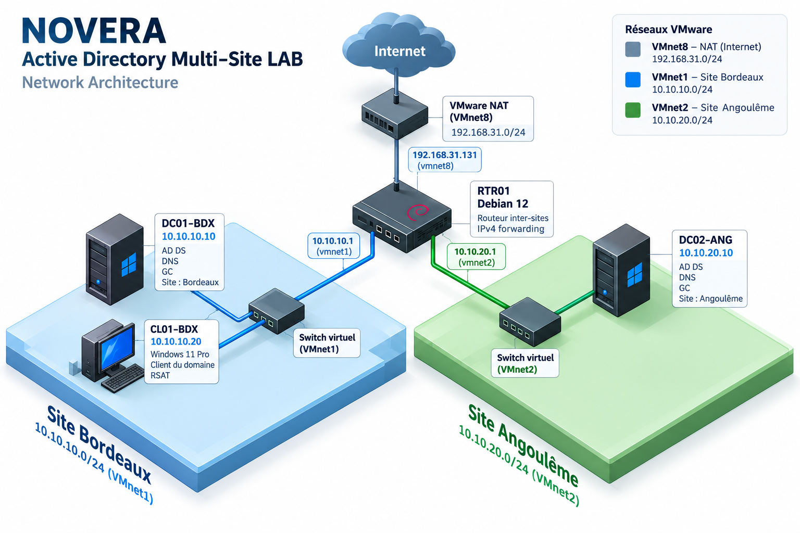
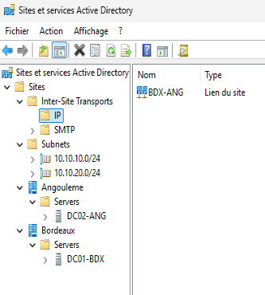
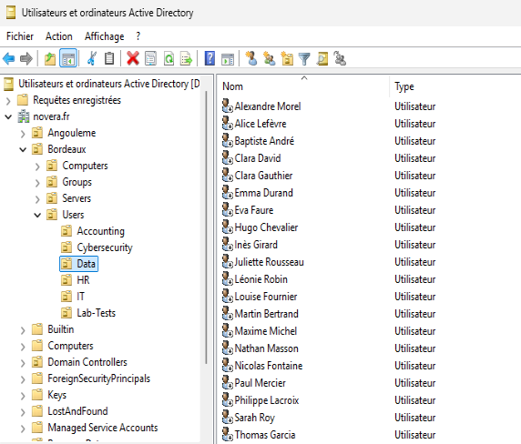
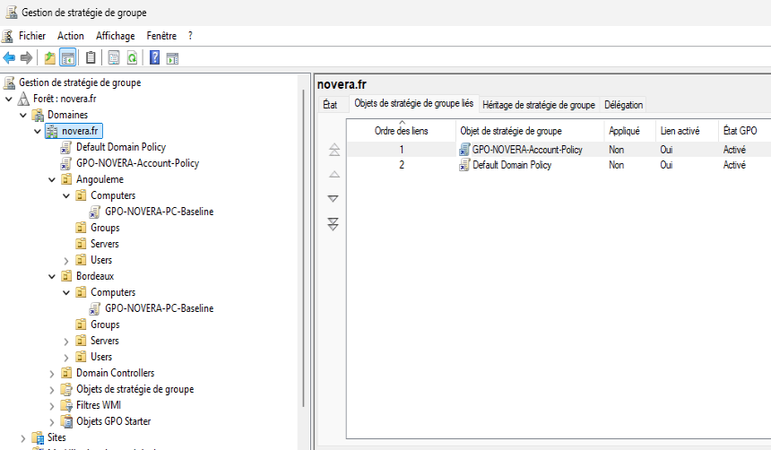

# Multi-Site Active Directory Infrastructure Lab

**Status:** 🟢 Done

## Table of Contents

- [1. Introduction](#1-introduction)
- [2. Objectives](#2-objectives)
- [3. Architecture Overview](#3-architecture-overview)
- [4. Active Directory Design](#4-active-directory-design)
- [5. Implemented Features](#5-implemented-features)
- [6. Deployment Guide](#6-deployment-guide)
- [7. Validation Results](#7-validation-results)
- [8. Repository Structure](#8-repository-structure)
- [9. Limitations and Future Improvements](#9-limitations-and-future-improvements)
- [10. References](#10-references)

<br/>  
<br/>

## 1. Introduction

This project documents the deployment and configuration of a multi-site Active Directory Domain Services (AD DS) infrastructure in a virtualized environment.

The lab simulates a company operating across two French locations: Bordeaux and Angoulême. Each site has its own subnet and domain controller, while both locations belong to the same Active Directory forest.

The infrastructure is built with :
- VMware Workstation Pro
- Windows Server 2025
- Windows 11 Pro
- Debian 12 router

### Business Scenario

NOVERA is a company operating across two sites: Bordeaux and Angouleme. Each site has its own network and local IT administration requirements.

The Bordeaux IT team is responsible for the day-to-day administration of its local environment, while the Angouleme IT team manages the resources at its own site.

NOVERA also has a **Cybersecurity team based in Bordeaux**, responsible for protecting the corporate network as a whole. Its scope includes both Bordeaux and Angouleme, regardless of the team's physical location.

This organizational model introduces two distinct administrative needs:

- **Local autonomy:** IT teams must be able to perform their assigned administrative tasks within their own site's scope.
- **Cross-site security:** the Cybersecurity function must operate across the entire corporate environment, with access and privileges explicitly defined according to its responsibilities.

The Active Directory design reflects these requirements through site-specific organizational units, delegated administration, and security groups intended to represent both local and cross-site functions.

The lab demonstrates how a multi-site Active Directory environment can reflect an organization's real administrative responsibilities while keeping permissions explicit and scoped to the required tasks.

<br/>  
<br/>

## 2. Objectives

| Professional skill | What this lab demonstrates |
|---|---|
| Windows infrastructure administration | Deployment and configuration of Windows Server domain controllers |
| Active Directory administration | Domain, OU, user, and security group management |
| Multi-site infrastructure | Separate site subnets, AD Sites and Services, and inter-site replication |
| Group Policy management | Configuration and functional validation of workstation and account policies |
| Delegated administration | Scoped delegation of user-account management permissions |
| File access management | SMB share configuration and NTFS permission management |
| PowerShell automation | Scripted employee import and associated test files |
| Network administration | Inter-site routing using a Debian router |

Cloud identity synchronization and broader infrastructure automation are potential future improvements, not completed objectives.

<br/>  
<br/>

## 3. Architecture Overview

The lab consists of two Active Directory sites connected through a Debian router.

- **Bordeaux:** primary lab site, including the first domain controller and a Windows client.
- **Angoulême:** second site, including the second domain controller.
- **Routing:** Debian 12 router connecting both site subnets and providing external connectivity for the lab.

The two domain controllers belong to the same forest and domain: `novera.fr`.

The router enables IPv4 forwarding between the two site networks. Its NAT-facing interface provides external connectivity for the lab.



<br/>  
<br/>

## 4. Active Directory Design

**Forest and domain:** `novera.fr`  
**NetBIOS domain name:** `NOVERA`

### Site Topology

The lab uses a single Active Directory forest and domain across two geographical sites:

- `Bordeaux`, associated with subnet `10.10.10.0/24`.
- `Angouleme`, associated with subnet `10.10.20.0/24`.

The sites are connected through the `BDX-ANG` site link. Active Directory Sites and Services represents the physical network topology and supports site-aware domain controller discovery and replication.

### Organizational Unit Design

The OU hierarchy follows a **site-first approach**, with resources separated by object type and user accounts further organized by department.

The structure is designed around the following principles:

- **Location-based administration:** separating Bordeaux and Angouleme provides clear administrative boundaries between the two locations.
- **Delegation scope:** site-specific OU branches make it easier to delegate administrative tasks to local IT teams without intentionally granting them the same scope across the entire domain.
- **Object separation:** dedicated OUs for users, computers, servers, and groups provide a clearer structure for administration and targeted Group Policy application.
- **Departmental organization:** user OUs are subdivided by department to make user management and the application of department-specific policies easier when required.
- **Separation of administration and access control:** OUs organize objects and define potential delegation and Group Policy scopes, while security groups are used to assign permissions to resources.

### Rationale and Trade-offs

A site-first hierarchy was chosen because the lab focuses on a multi-site organization in which administrative responsibilities may differ by location. It also provides a practical structure for testing delegated administration within a defined OU boundary.

An alternative would be to organize all users and computers primarily by department, regardless of location. That approach can be appropriate when departments are the main administrative boundary. For this lab, however, location was selected as the first organizational dimension because site-based administration and delegation are key objectives.

This OU hierarchy is a logical administrative design; it does not itself control network routing or Active Directory replication. Those functions are handled by the network configuration and Active Directory Sites and Services, respectively.

<br/>  
<br/>

## 5. Implemented Features

### Active Directory Infrastructure

- Two Windows Server 2025 domain controllers deployed in the `novera.fr` forest.
- DNS installed on both domain controllers.
- Two AD sites configured: Bordeaux and Angoulême.
- Site subnets and the `BDX-ANG` site link configured.
- Inter-site replication validated after the initial synchronization period.



### Organizational Structure and Identity Management

- Site-based organizational unit hierarchy created.
- Departmental user OUs and security groups configured.
- Employee data imported using PowerShell automation.
- Employee import tests maintained in the `tests/` directory.



Relevant files:
- [`scripts/import-employees.ps1`](scripts/import-employees.ps1)
- [`tests/test-employees.ps1`](tests/test-employees.ps1)

### Group Policy

- Workstation inactivity lock policy configured and tested.
- Domain account lockout policy configured and tested.



### Delegated Administration

- Delegated user-account administration configured for the Bordeaux IT administration group.
- User creation, description modification, and password reset tested with a delegated account.


### Network Share and File Permissions

- SMB share created at `\\DC01-BDX\IT-Bordeaux`.
- `GG_Bordeaux_IT` granted Modify permissions at the SMB share and NTFS levels.
- `Administrateurs` granted Full Control at the SMB share level.
- Access tested with an authorized IT user and a non-IT user.

<br/>  
<br/>

## 6. Deployment and Configuration

The lab was deployed manually in VMware Workstation Pro, with PowerShell used for employee data import and validation.

<details>
<summary><strong>Infrastructure deployment</strong></summary>

1. Create the VMware networks for Bordeaux (`10.10.10.0/24`), Angoulême (`10.10.20.0/24`), and NAT connectivity.
2. Deploy the Debian 12 router and configure its three network interfaces and IPv4 forwarding.
3. Install Windows Server 2025 on both domain controllers and assign static IP addresses.
4. Promote `DC01-BDX` to create the `novera.fr` forest, then join `DC02-ANG` as an additional domain controller.
5. Configure DNS, Active Directory sites, subnets, and the `BDX-ANG` site link.
6. Create the site-based OU structure, security groups, and employee accounts.
7. Join `CL01-BDX` to the domain and configure Group Policies.

</details>

<details>
<summary><strong>Delegated administration</strong></summary>

- Create the `GG_Bordeaux_IT_Admins` security group.
- Delegate user-account management within `Bordeaux\Users`.
- Validate user creation, description modification, and password reset with a delegated account.
- Verify that the delegated account cannot reset passwords outside its intended administrative scope.

</details>

<details>
<summary><strong>Network share configuration</strong></summary>

- Create `C:\Shares\IT-Bordeaux` on `DC01-BDX` and publish it as `\\DC01-BDX\IT-Bordeaux`.
- Grant `GG_Bordeaux_IT` Modify permissions at the SMB share and NTFS levels.
- Grant `Administrateurs` Full Control at the SMB share level.
- Test file creation with an authorized IT account and verify access denial for a non-IT account.

</details>

<details>
<summary><strong>Validation and testing</strong></summary>

- Check domain membership and inter-site connectivity.
- Verify AD replication using `repadmin /replsummary`.
- Test the workstation inactivity lock and domain account lockout policies.
- Validate delegated administration and SMB share access.
- Run the employee import validation script when its test status needs to be confirmed.

</details>

<br/>  
<br/>

## 7. Validation Results

The core infrastructure components were validated through functional checks performed during the lab deployment. The following table summarizes the validation method and the expected evidence.

| Component | Validation procedure | Expected evidence | Screenshots                                                                                                                                                                                                                               |
|---|---|---|-------------------------------------------------------------------------------------------------------------------------------------------------------------------------------------------------------------------------------------------|
| Domain membership | On `CL01-BDX`, run `whoami` and `systeminfo` to check the logged-in domain account and computer domain membership. | The workstation belongs to `novera.fr`, and the logged-in account uses the domain identity when applicable.                                                     | [`Domain_membership.png`](images/Domain_membership.png)                                                                                                                                                                                   
| Inter-site networking | Run `ping 10.10.20.10` from the Bordeaux network to check connectivity to `DC02-ANG`. Use `nslookup DC02-ANG.novera.fr` to validate DNS name resolution. | The remote domain controller is reachable, and its hostname resolves to `10.10.20.10`.                                                                          | [`Intersite_networking.png`](images/Intersite_networking.png)                                                                                                                                                                             
| Active Directory replication | On a domain controller, run `repadmin /replsummary`. | The replication summary reports no replication errors after synchronization has completed.                                                                      | [`AD_replication.png`](images/AD_replication.png)                                                                                                                                                                                         
| Workstation Group Policy | Run `gpresult /r /scope computer` on `CL01-BDX` to inspect applied computer policies. Check the configured inactivity-lock setting and verify that the workstation locks after 15 minutes of inactivity. | The relevant computer policy is applied, and the inactivity lock behaves as configured.                                                                         | [`Workstation_GroupPolicy.png`](images/Workstation_GroupPolicy.png)                                                                                                                                                                       
| Domain account lockout policy | On a domain controller, run `Get-ADDefaultDomainPasswordPolicy`. In the lab, a temporary test account was used to verify lockout after five incorrect password attempts. | The domain policy shows the configured threshold and lockout duration; the test account locks after the configured number of failed attempts.                   | [`Domain_account_lockout_policy.png`](images/Domain_account_lockout_policy.png) [`Account_lockedout.png`](images/Account_lockedout.png)                                                                                                                                                          
| Delegated administration | Sign in to `CL01-BDX` with the delegated Bordeaux IT account. Create a test user under the authorized Bordeaux OU, modify its description, and reset its password. Attempting a password reset outside the delegated scope should be denied. | Authorized operations succeed within the tested scope, while the tested operation outside that scope is denied.                                                 | [`Delegated_administration_GRP.png`](images/Delegated_administration_GRP.png) [`Delegated_administration_BDX.png`](images/Delegated_administration_BDX.png) [`Delegated_administration_ANG.png`](images/Delegated_administration_ANG.png) 
| SMB share access | Access `\\DC01-BDX\IT-Bordeaux` using an authorized member of `GG_Bordeaux_IT`, then create a test file. Repeat the access check with a non-IT account. | The authorized IT user can create a file; the tested non-IT account is denied access.                                                                           | [`SMB_share_access_GRP.png`](images/SMB_share_access_GRP.png) [`SMB_share_access_IT.png`](images/SMB_share_access_IT.png) [`SMB_share_access_NonIT.png`](images/SMB_share_access_NonIT.png)                                               
| Employee import | Review `scripts/import-employees.ps1` and `tests/test-employees.ps1`. Run the test script in the intended lab environment when validating the import process. | The script and test file are present in the repository. Test execution results must be recorded separately before claiming that the import tests pass.          |

These results document the functional checks performed in this lab. They do not constitute a complete production-readiness, security-audit, or disaster-recovery assessment.

<br/>  
<br/>

## 8. Repository Structure
<details>
<summary>View repository structure</summary>

```text
.
├── data/
│   ├── employees.json
│   ├── references.json
│   └── roles.json
├── docs/
│   ├── images/
│   │   └── DNS_manager.png
│   │   └── GPO_strategies.png
│   │   └── Group_delegation_ITAdmins.png
│   │   └── ITFolder_permissions.png
│   │   └── Network_access_validation.png
│   │   └── Network_diagramm.png
│   │   └── OU_structure.png
│   │   └── Server_replication_results.png
│   │   └── Sites_structure.png
├── scripts/
│   └── import-employees.ps1
├── tests/
│   └── test-employees.ps1
└── README.md
```
</details>

### Directory Overview

| Path | Purpose |
|---|---|
| `data/` | Employee data and reference data used by the import process |
| `docs/` | Documentation covering delegated administration, user-account management, and network share permissions |
| `scripts/` | PowerShell scripts used to automate administrative tasks |
| `tests/` | Tests for employee import functionality |
| `README.md` | Project overview, architecture, deployment scope, and validation results |

<br/>  
<br/>

## 9. Limitations and Future Improvements

### Current Limitations

- The file share is hosted on `DC01-BDX`, a domain controller. A dedicated file server would provide a clearer separation of roles.
- Inherited NTFS permissions remain in place on the shared folder. A more restrictive permissions review may be appropriate depending on the intended access policy.
- The lab validates core Active Directory functionality but does not constitute a full production-readiness assessment.
- Backup and disaster recovery procedures have not been implemented as part of the current scope.
- The deployment is only partially automated; not every infrastructure configuration step is performed by script.

### Potential Improvements

- Move file sharing to a dedicated member server.
- Review NTFS inheritance and document the intended effective permissions.
- Expand PowerShell automation for repeatable infrastructure deployment.
- Add automated validation for DNS, domain controller health, and replication.
- Implement and test backup and recovery procedures.
- Explore Microsoft Entra ID integration and directory synchronization as a separate project phase.

<br/>  
<br/>

## 10. References

- [Microsoft Learn — Active Directory Domain Services](https://learn.microsoft.com/windows-server/identity/ad-ds/)
- [Microsoft Learn — Group Policy](https://learn.microsoft.com/windows-server/identity/ad-ds/manage/group-policy/group-policy-overview)
- [Microsoft Learn — Active Directory replication](https://learn.microsoft.com/windows-server/identity/ad-ds/get-started/replication/active-directory-replication-concepts)
- [Debian Documentation](https://www.debian.org/doc/)
- [VMware Workstation Pro](https://www.vmware.com/products/desktop-hypervisor/workstation-and-fusion)

<br/>
<br/> 


## Author
**Furlan Marine - Certified AWS Solutions Architect - Associate** \
📌https://www.linkedin.com/in/marinefurlan/ \
🎓https://www.credly.com/badges/06426b31-106e-4251-b866-6da8f4200e68/linked_in?t=t7j3hl